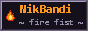

  
  <!-- swap for Miyamura:  -->

<h1 align="center">hi, i'm nikhil!</h1>

  

<h3 align="center">welcome to my profile ~ 🔥</h3>

  student · developer · fueled by anime and too much coffee

  <b><a href="https://github.com/NikBandi">GitHub</a></b> |
  <b><a href="https://www.linkedin.com/in/sri-nikhil-bandi">LinkedIn</a></b> |
  <b><a href="mailto:nivasbandi1234@gmail.com">Email</a></b>

  <i>living with no regrets.</i>

